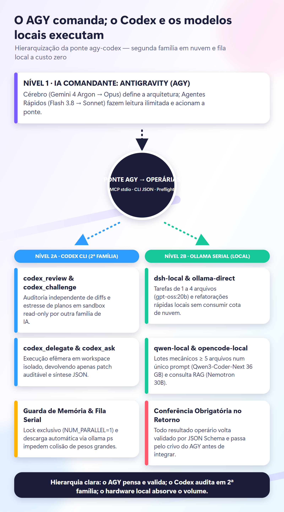
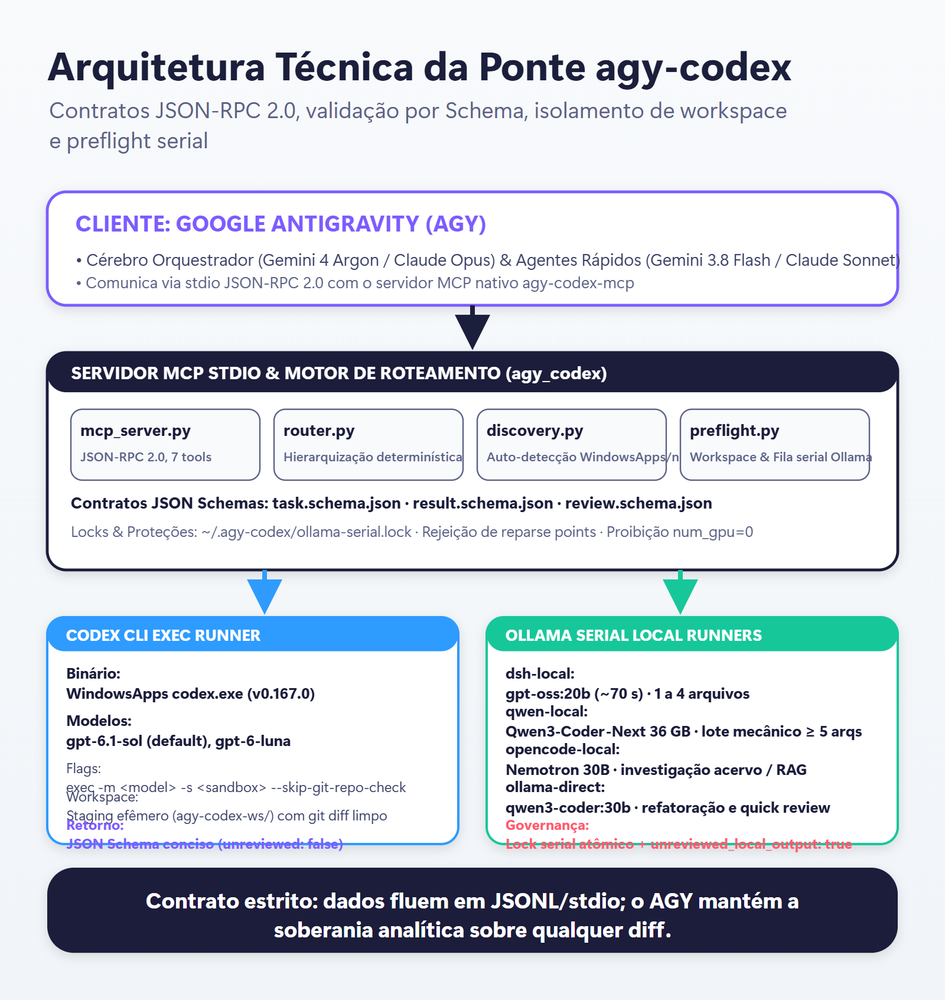

# agy-codex

> **Ponte AGY -> Codex & Modelos Locais:** servidor MCP stdio, CLI Python e fila serial Ollama comandados pelo Google Antigravity.

---

<p align="center">
  
  <br />
  <em>Diagrama de Hierarquização da Ponte agy-codex (<a href="docs/hierarquia-motion.svg">versão vetorial SVG</a>).</em>
</p>

---

## 1. Visão Geral

O projeto **`agy-codex`** estabelece o canal determinístico onde o **Google Antigravity (AGY)** atua como a **Inteligência Artificial Comandante**, orquestrando o **Codex** (como 2ª família técnica independente em nuvem) e os **executores locais do Ollama** (para absorção de trabalho mecânico e consultas locais a custo zero).

### Principais Capacidades:
- **Auditoria de 2ª Família (`codex_review` & `codex_challenge`):** O Cérebro do AGY (`Gemini 4 Argon` → `Claude Opus`) aciona o Codex (`gpt-6.1-sol`) em sandbox read-only para estressar trade-offs e revisar diffs com olhar independente.
- **Delegação em Workspace Efêmero (`codex_delegate`):** Implementação em diretório isolado (`agy-codex-ws/<id>`) com sandbox `workspace-write`, devolvendo apenas patch git auditável e resumo estruturado.
- **Fila Serial Estrita Ollama (`local_dispatch`):** Despacho atômico para `dsh-local` (`gpt-oss:20b`), `qwen-local` (`Qwen3-Coder-Next 36 GB`) e `opencode-local` (`nemotron-3.5-lightning:30b-a3b`), com lock exclusivo (`~/.agy-codex/ollama-serial.lock`) e descarregamento automático de modelos concorrentes via `ollama ps`.
- **Governança Estrita:** Todas as saídas locais são obrigatoriamente marcadas com `"unreviewed_local_output": true` para crivo obrigatório do AGY antes da integração.

---

<p align="center">
  
  <br />
  <em>Arquitetura Técnica e Contratos da Ponte (<a href="docs/arquitetura-ponte.svg">versão vetorial SVG</a>).</em>
</p>

---

## 2. Estrutura do Repositório

```
agy-codex/
├── pyproject.toml              # Configuração do pacote Python
├── src/
│   └── agy_codex/
│       ├── cli.py              # CLI unificada (status, route, ask, review, delegate, local, mcp)
│       ├── discovery.py        # Detecção automática de binários (WindowsApps, npm, PATH)
│       ├── router.py           # Motor determinístico de hierarquização
│       ├── preflight.py        # Guards de workspace, flags Ollama e trava serial
│       ├── workspace.py        # Isolamento em workspace efêmero e extração de patches
│       ├── runner.py           # Executores do Codex CLI e Ollama local
│       ├── mcp_server.py       # Servidor MCP stdio JSON-RPC 2.0 (7 ferramentas)
│       └── contracts.py        # Validação determinística de contratos
├── schemas/                    # Schemas JSON (task, result, review)
├── skills/agy-codex/           # Skill declarativa para o Antigravity
├── docs/                       # Documentação técnica e diagramas Motion e Okabe-Ito
├── scripts/gerar_diagramas.py  # Gerador determinístico de diagramas SVG/PNG (escala 1.6x)
└── tests/test_agy_codex.py     # Suíte de testes automatizados com pytest (100% passed)
```

---

## 3. Uso via CLI

```powershell
# 1. Verificar status de todos os executores e binários da máquina
python -m agy_codex status

# 2. Consultar roteamento determinístico
python -m agy_codex route --operation review
python -m agy_codex route --operation local --files 6

# 3. Solicitar auditoria independente ao Codex
python -m agy_codex review "Analise este diff quanto a regressões de concorrência..."

# 4. Despachar tarefa local pesada sob lock serial
python -m agy_codex local --worker qwen-local "Refatore a assinatura destas funções..."
```

---

## 4. Integração MCP no Antigravity

Adicione a ponte no `mcp_config.json` do AGY:

```json
{
  "mcpServers": {
    "agy-codex": {
      "command": "python",
      "args": ["-m", "agy_codex.mcp_server"],
      "env": {
        "PYTHONPATH": "C:/Github/agy-codex/src"
      }
    }
  }
}
```

---

## 5. Testes Automatizados

```powershell
$env:PYTHONPATH = "src"
python -m pytest tests/ -v
```
